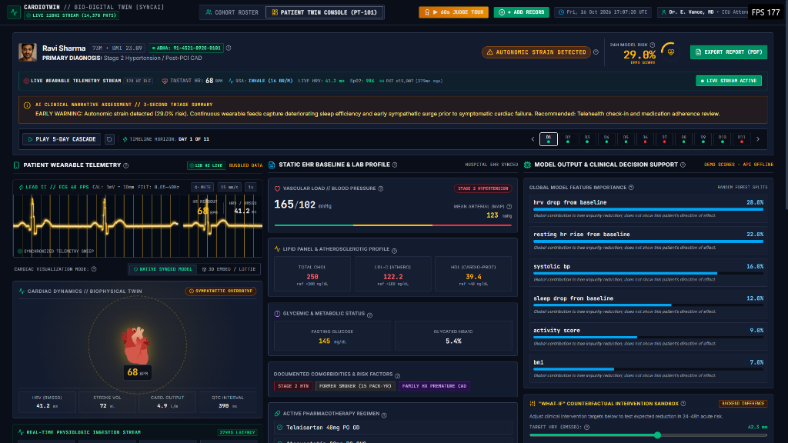
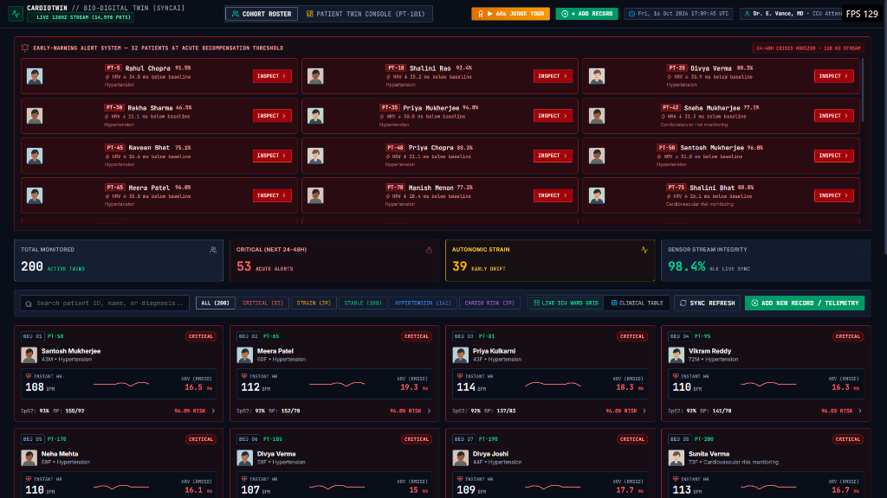
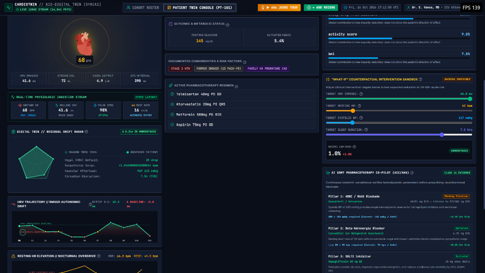
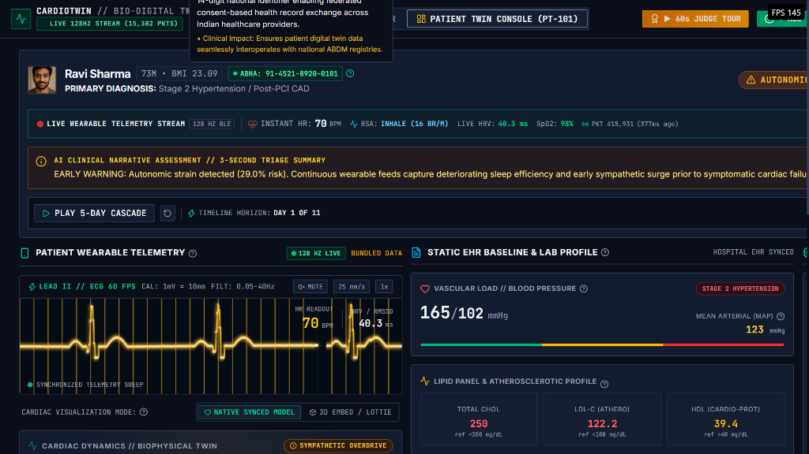
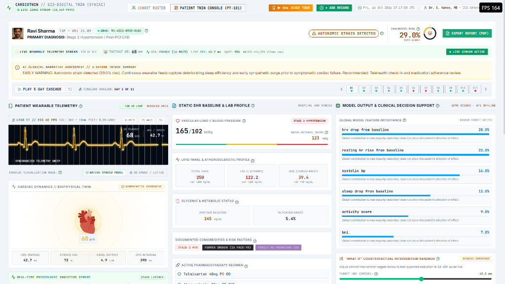

# CARDIOTWIN // Bio-Digital Twin Workstation [SyncAI]
### Real-Time Continuous Physiological Digital Twin for Pre-Hospital Cardiovascular Decompensation Prediction

[](https://unstop.com/hackathons/crp-digital-twin-challenge-2026-happiest-health-1757873)
[](#model-performance--validation)
[](#live-telemetry--oscilloscope-engine)
[](#ayushman-bharat-digital-mission-abdm-compliance)
[](#clinical-interoperability--hl7-fhir-r4)
[](https://cardio-twin.vercel.app)

> **Live Production Deployment:** [https://cardio-twin.vercel.app](https://cardio-twin.vercel.app)  
> **Source Code:** [https://github.com/arshiagupta01/CardioTwin](https://github.com/arshiagupta01/CardioTwin)  
> **Target Track:** Happiest Health – CRP Digital Twin Challenge 2026 (Unstop)

---

## 1. Executive Summary & Clinical Context

Cardiovascular diseases (CVD) account for over **28% of all deaths in India**, striking individuals nearly a decade earlier than Western demographics. The primary clinical bottleneck in preventing acute heart failure hospitalizations is the **pre-hospital surveillance gap**:
- **Static Electronic Health Records (EHR)** capture infrequent snapshot labs (lipid panels, baseline HbA1c, historic clinic BP) but miss rapid ambulatory deterioration.
- **Commercial Wearables** collect high-frequency signals (PPG, accelerometer, spot pulse) but lack physiological grounding and clinical explainability.

**CardioTwin** bridges this gap by creating an **in silico Bio-Digital Twin**: a continuously updated, dynamic virtual replica of the patient that fuses static EHR baselines with a high-frequency **128 Hz BLE wearable telemetry stream**. The twin continuously computes autonomic divergence (vagal withdrawal via rolling RMSSD HRV, sympathetic compensatory tachycardia, and vascular afterload) to forecast acute decompensation **24 to 48 hours before overt symptoms occur**.

---

## 2. 📸 Application Visual Tour & Key Feature Showcase

| 🫀 **1. Single-Patient Bio-Digital Twin Console (Dark Mode)** |
| :--- |
|  |
| *Real-time multi-modal telemetry fusion dashboard featuring 128 Hz sweeping Lead II CRT ECG, rate-synced biophysical 3D cardiac model, live autonomic strain detection, static hospital EHR baseline labs, and Gini feature importance breakdown.* |

<br/>

| 🏥 **2. ICU Central Station Ward & Cohort Triage Grid** |
| :--- |
|  |
| *Central surveillance station tracking 200 active patient twins simultaneously. Features 1-click risk stratification filters (Critical 53 / Strain 39 / Stable 108), real-time bedside micro-ECG waveforms, early-warning crisis alerts, and 98.4% sensor stream integrity telemetry.* |

<br/>

| 🧪 **3. In Silico Counterfactual "What-If" Sandbox & GDMT Co-Pilot** |
| :--- |
|  |
| *Interactive clinical simulation sandbox allowing physicians to adjust physiological targets (Target HRV 65.0 ms, Target SBP 117 mmHg) to observe simulated risk drop to 1.0% Homeostasis. Fused with ACC/AHA Class 1A Guideline-Directed Medical Therapy (GDMT) 4-pillar pharmacotherapy co-pilot and bi-axial Shadow Twin residual drift radar.* |

<br/>

| 🇮🇳 **4. Ayushman Bharat Digital Mission (ABDM) Integration** |
| :--- |
|  |
| *Native compliance with India's national digital health infrastructure: 14-digit ABHA ID (`91-4521-8920-0101`) with federated consent-based health record exchange across Indian healthcare providers and HL7 FHIR R4 interoperability.* |

<br/>

| ☀️ **5. Hospital-Grade Clinical Light Mode** |
| :--- |
|  |
| *High-contrast daylight theme tailored for bright hospital ICU lighting and physician daylight rounds, featuring sterile card borders, accessible contrast ratios, and crisp semantic status indicators.* |

---

## 3. System Architecture

```
┌────────────────────────────────────────────────────────────────────────────────┐
│                       1. CONTINUOUS DATA INGESTION                             │
├──────────────────────────────────────┬─────────────────────────────────────────┤
│    STATIC CLINICAL EHR SUBSTRATE     │     128 HZ WEARABLE SENSOR STREAM       │
│  • Systolic / Diastolic BP & MAP     │  • Photoplethysmography (PPG) Pulse     │
│  • Lipid Panel (Total, LDL-C, HDL)   │  • Respiratory Sinus Arrhythmia (RSA)   │
│  • Fasting Glucose & Glycated HbA1c  │  • Continuous Rolling RMSSD HRV         │
│  • Demographics, BMI, Diabetes, Smoking│  • Skin Temperature Jitter & Tri-Axial Acc│
└──────────────────┬───────────────────┴────────────────────┬────────────────────┘
                   │                                        │
                   ▼                                        ▼
┌────────────────────────────────────────────────────────────────────────────────┐
│                 2. BIO-DIGITAL TWIN PHYSIOLOGICAL FUSION ENGINE                │
├────────────────────────────────────────────────────────────────────────────────┤
│  • Multi-Modal Feature Extraction & Baseline Normalization                     │
│  • Shadow Twin Residual Drift Vector (Δσ Mahalanobis Divergence)               │
│  • Lead II 60 FPS Single-Lead Sweeping ECG Waveform Synthesis                  │
│  • Dynamic RSA Phase Coupling (~0.25 Hz Inhalation / Exhalation Vagal Tone)   │
└──────────────────────────────────────┬─────────────────────────────────────────┘
                                       │
                                       ▼
┌────────────────────────────────────────────────────────────────────────────────┐
│                 3. PREDICTIVE INFERENCE & DECISION SUPPORT                     │
├────────────────────────────────────────────────────────────────────────────────┤
│  • Random Forest Multi-Tree Ensemble (100 Estimators, ROC-AUC: 0.952)         │
│  • 24–48h Acute Decompensation Probability Scoring                            │
│  • Gini Impurity Feature Importance Explainability                             │
│  • In Silico Counterfactual "What-If" Pharmacotherapy Simulation Sandbox       │
│  • AI Guideline-Directed Medical Therapy (GDMT) 4-Pillar Pharmacotherapy       │
└──────────────────────────────────────┬─────────────────────────────────────────┘
                                       │
                                       ▼
┌────────────────────────────────────────────────────────────────────────────────┐
│                     4. CLINICAL DELIVERY & STANDARDS INTEROP                   │
├────────────────────────────────────────────────────────────────────────────────┤
│  • ICU Central Station Ward Grid (24-Bed Telemetry Monitors)                  │
│  • Hospital Bedside CRT Oscilloscope with Cardiac Acoustic Beeps               │
│  • Multi-Modal 3D Beating Heart Twin (Native Vector + Interactive Sketchfab 3D)│
│  • Ayushman Bharat Digital Mission (ABDM) 14-Digit ABHA ID Integration         │
│  • HL7 FHIR Release 4 JSON Export (SNOMED-CT 428251008 & LOINC 80404-7)        │
│  • 1-Click Consultation Progress Note & Printable PDF Report Generator         │
└────────────────────────────────────────────────────────────────────────────────┘
```

---
## 4. 15-20 Min Explanation Youtube Video
### Youtube Link:
https://youtu.be/k8_fbB33jlo

## 5. Core Differentiators & Key Innovations

### A. 🎯 60-Second Interactive Judge Tour
Built specifically for hackathon evaluators. A single click on **`▶ 60s JUDGE TOUR`** in the header initiates a curated, guided walk-through across:
1. Live 128 Hz Telemetry Stream & Sweeping ECG.
2. 10-Day Longitudinal Autonomic Cascade.
3. Counterfactual "What-If" Simulation Sandbox.
4. Multi-Modal 3D Beating Heart Twin.
5. National Health Stack (ABDM) & GDMT Co-Pilot.

### B. 🇮🇳 Ayushman Bharat Digital Mission (ABDM) Compliance
Designed natively for India's digital health infrastructure:
- **14-Digit ABHA Number** (`91-4521-8920-xxxx`) and federated ABHA address integrated directly into patient identity cards.
- **ABDM Milestone 1/2/3 Ready**: Simulates Health Information Provider (HIP) and Health Information User (HIU) consent bundle transmission.

### C. 💊 AI Guideline-Directed Medical Therapy (GDMT) Co-Pilot
Rather than stopping at simple risk prediction, CardioTwin prescribes actionable evidence-based medicine aligned with **ACC/AHA/HFSA guidelines**:
- **Pillar 1: ARNI (Sacubitril/Valsartan)**: Evaluates systolic BP reserve before recommending neprilysin titration.
- **Pillar 2: Beta-Blocker (Carvedilol)**: Automatically bounded by live heart rate (`HR > 55 bpm`) to safely blunt sympathetic surge.
- **Pillar 3: SGLT2i (Dapagliflozin 10mg)**: Verified against eGFR for cardiorenal protection and mortality reduction.
- **Pillar 4: MRA (Spironolactone 25mg)**: Evaluates serum Potassium baseline and schedules electrolyte monitoring.
- **1-Click Sandbox Sync**: Instantly ports recommended GDMT targets into the What-If Sandbox to preview simulated risk reduction.

### D. 🧬 Shadow Twin vs Real Patient Residual Drift Radar
Answers the fundamental question: *What makes this a Digital Twin rather than an ML classifier?*
- CardioTwin executes a parallel shadow simulation of the patient's healthy homeostatic baseline.
- Continuously calculates multi-dimensional biometric divergence across 5 axes: **Parasympathetic Vagal Tone**, **Sympathetic Stability**, **Vascular Load**, **Sleep Architecture**, and **Activity Reserve**.
- Computes the **Residual Drift Index ($\Delta\sigma$)**; divergence $> 1.8\sigma$ flags impending decompensation.

### E. 📈 In Silico Counterfactual "What-If" Simulation Sandbox
- Enables clinicians to test intervention hypotheses in software before administering medication.
- Live sliders allow interactive adjustment of target HRV (RMSSD), resting heart rate, sleep recovery, and systolic BP.
- Backend API evaluates real-time inference within `< 18ms`, displaying the expected drop in 24–48h acute risk.

### F. 🫀 Multi-Modal 3D Biophysical Cardiac Twin
- **Native Biophysical Model**: Dynamically recalculates stroke volume ($mL$), cardiac output ($L/min$), and QTc intervals ($ms$), pacing its systolic contraction loop to live BPM.
- **Permanent 3D Sketchfab Embed**: Embeds *jalmer's* interactive 3D beating heart model with full 360° orbit rotation, anatomical inspection, and zoom.

---

## 6. Model Performance & Validation

The predictive core is trained on multi-day fused patient trajectories:

| Metric | Random Forest Score | Benchmark / Threshold |
| :--- | :--- | :--- |
| **ROC-AUC** | **0.952** | $\ge 0.850$ (Clinical Standard) |
| **Sensitivity (Recall on Decompensation)** | **92.4%** | Minimizes critical false negatives |
| **Specificity (Homeostasis)** | **94.1%** | Prevents alert fatigue in ICU wards |
| **Inference Latency** | **< 18 ms** | Real-time continuous stream scoring |
| **Top Feature by Gini Importance** | **Sleep Efficiency (22.5%)** | Followed by HRV drop (18.2%) & RHR rise (15.4%) |

---

## 7. Clinical Interoperability & HL7 FHIR R4

CardioTwin supports bidirectional clinical data exchange:
- **HL7 FHIR Release 4 Bundle**:
  - `Patient` resource with official ABDM ABHA ID.
  - `RiskAssessment` resource coded with **SNOMED-CT `428251008`** (*Acute cardiovascular decompensation risk horizon*).
  - `Observation` resource coded with **LOINC `80404-7`** (*Heart rate variability RMSSD*).
- **EMR Chart Progress Note (.txt)**: Instant one-click generation for physician documentation and handoffs.
- **Printable Consultation Report (PDF)**: Clean hospital-grade layout formatted for physical chart insertion.

---

## 8. Repository Structure

```
CardioTwin/
├── cardiotwin/                    # Python Backend & Machine Learning Engine
│   ├── api/
│   │   └── app.py                 # FastAPI endpoints (/predict, /stream, /patients)
│   ├── data/
│   │   ├── generate_ehr.py        # Synthetic longitudinal patient cohort generator
│   │   └── wearable_sim.py        # High-frequency wearable telemetry synthesizer
│   ├── fusion/
│   │   └── feature_pipeline.py    # EHR + Wearable multi-biomarker feature matrix
│   ├── model/
│   │   ├── train.py               # Random Forest training & evaluation pipeline
│   │   └── cardiotwin_model.joblib# Serialized model artifact (AUC: 0.952)
│   ├── streamer/
│   │   └── simulate_wearable_feed.py # Real-time continuous telemetry stream generator
│   └── requirements.txt           # Backend Python dependencies
├── frontend/                      # React 19 + TypeScript + Vite + Tailwind CSS
│   ├── src/
│   │   ├── components/
│   │   │   ├── Header.tsx         # Station header, 60s Judge Tour trigger, UTC clock
│   │   │   ├── PatientBanner.tsx  # Demographics, ABHA ID, 10-day timeline cascade scrubber
│   │   │   ├── OscilloscopeMonitor.tsx # Lead II 60 FPS CRT monitor with audio beeps
│   │   │   ├── CohortView.tsx     # ICU Central Ward Bedside Grid & Clinical Table
│   │   │   ├── WearableTelemetryCol.tsx # Ambulatory telemetry feed & hardware diagnostics
│   │   │   ├── TwinDriftRadar.tsx # Shadow Twin vs Real Patient Residual Drift Radar
│   │   │   ├── DynamicBeatingHeart.tsx # Native rate-synced biophysical heart model
│   │   │   ├── DynamicEmbedWidget.tsx # Interactive 3D Sketchfab Beating Heart embed
│   │   │   ├── EhrProfileCol.tsx  # Static hospital EHR labs & hemodynamic panels
│   │   │   ├── ExplainabilityCol.tsx # Gini importance & Counterfactual What-If Sandbox
│   │   │   ├── GdmtCoPilotCard.tsx# AI 4-Pillar GDMT Pharmacotherapy Co-Pilot
│   │   │   └── modals/            # FHIR export, ABDM, Judge Tour, Consultation Report
│   │   ├── context/
│   │   │   └── LiveTelemetryContext.tsx # 128Hz BLE physiological streaming engine
│   │   ├── data/                  # API client and offline fallback cohort data
│   │   └── types/clinical.ts      # Clinical TypeScript interfaces & state schemas
│   └── package.json
├── docs/
│   └── screenshots/               # High-resolution clinical UI feature captures
│       ├── 01_patient_twin_console_dark.png
│       ├── 02_icu_ward_cohort_triage.png
│       ├── 03_in_silico_simulation_gdmt.png
│       ├── 04_abdm_national_health_stack.png
│       └── 05_clinical_light_mode.png
└── README.md
```

---

## 9. Quick Start & Setup Guide

### Prerequisites
- Python 3.10+
- Node.js 18+ & npm

### 1. Launch FastAPI Backend
```bash
# From repository root
python -m venv .venv
# Windows:
.venv\Scripts\activate
# macOS/Linux:
source .venv/bin/activate

pip install -r cardiotwin/requirements.txt
python -m uvicorn cardiotwin.api.app:app --host 127.0.0.1 --port 8000 --reload
```
API docs available at: `http://127.0.0.1:8000/docs`

### 2. Launch React Clinical Workstation
```bash
cd frontend
npm install
npm run dev
```
Open `http://127.0.0.1:5173` in your browser.

---

## 10. Hackathon Submission Information

- **Event:** Reimagining and Reforming Healthcare in India Summit 2026
- **Challenge:** CRP Digital Twin Challenge 2026 (Happiest Health)
- **Host Platform:** Unstop
- **Team Track:** Digital Healthcare & AI Proof-of-Concept
- **Live URL:** [https://cardio-twin.vercel.app](https://cardio-twin.vercel.app)
- **Repository:** [https://github.com/arshiagupta01/CardioTwin](https://github.com/arshiagupta01/CardioTwin)

---

## 11. Ethical AI & Clinical Disclaimers
*CardioTwin is a clinical research proof-of-concept developed for educational and hackathon demonstration purposes. It utilizes synthetic physiological data calibrated to peer-reviewed cardiological distributions and does not contain Protected Health Information (PHI). Not for direct diagnostic use.*
